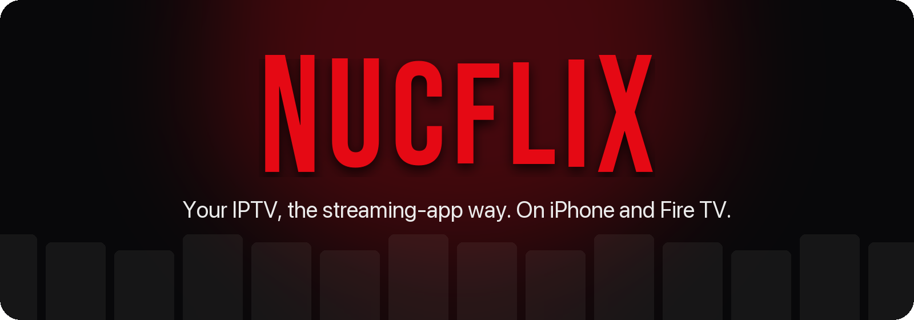
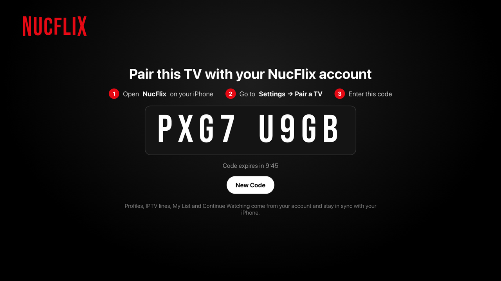
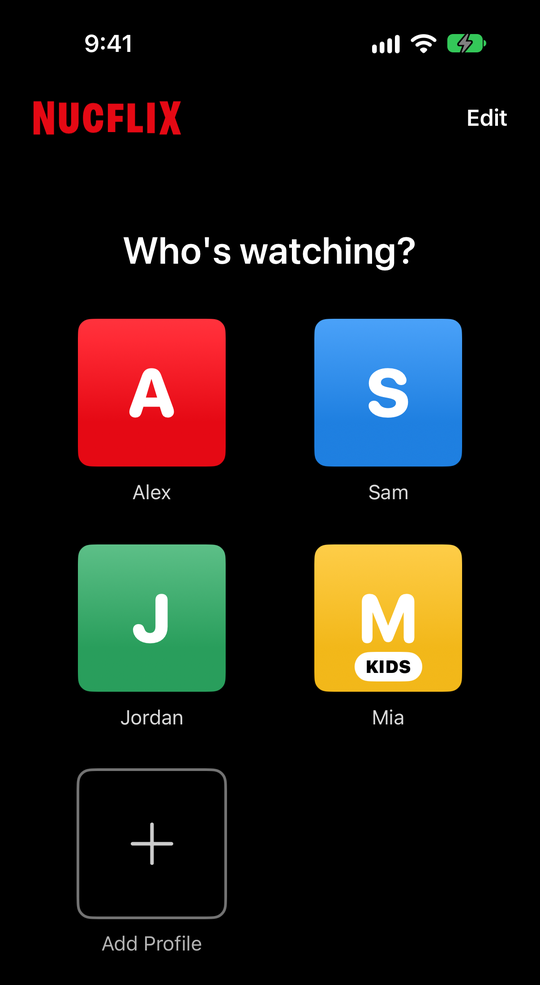
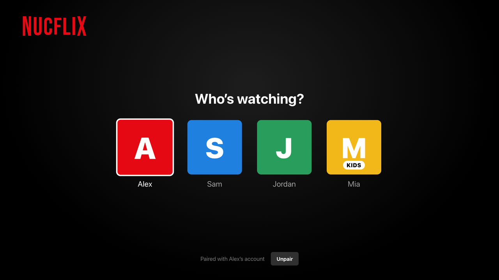
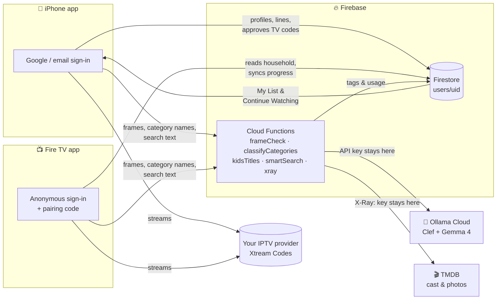
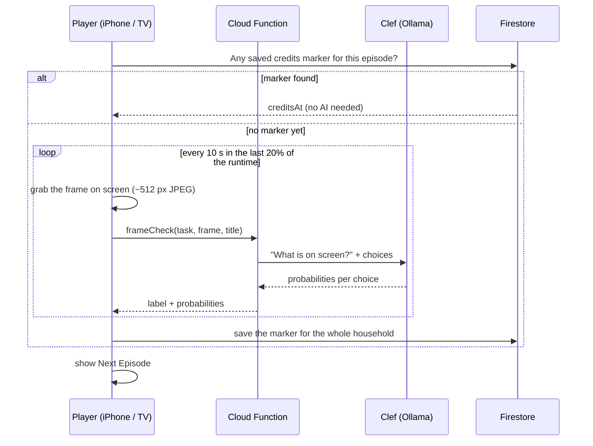

<div align="center">



<br>

**A Netflix-style home for your own IPTV subscription, on iPhone, Android and Fire TV, with one account across all of them.**

<br>


[](LICENSE)

**[🌐 Project website](https://pri-te-sh.github.io/NUCFLIX/)** · **[⬇️ Download for Android](https://github.com/pri-te-sh/NUCFLIX/releases/latest/download/NucFlix-Android.apk)**

[Features](#-features) · [Smart features](#-smart-features) · [Screenshots](#-screenshots) · [How it works](#-how-it-works) · [Getting started](#-getting-started) · [Project layout](#-project-layout) · [Privacy](#-privacy--security) · [License](#-license)

</div>

---

## ✨ Why NucFlix?

IPTV apps usually look like spreadsheets of channels. NucFlix turns any **Xtream Codes** line into a Netflix-style experience:

- Big artwork rows and a billboard.
- A "Who's watching?" screen with a profile for each person.
- Continue Watching that follows you from the couch to your phone.
- A bit of AI where it helps: it **sees** when the end credits really start, spots dead channels, keeps kids profiles kid-safe and understands searches like *"funny hindi movies from the 2010s"*.
- **X-Ray**, as on Prime Video, on the TV and the phones: pause and see who's in the scene, who they play, and what else they've been in.

You bring the IPTV subscription; NucFlix doesn't provide or host any content.

## 🚀 Features

<table>
<tr>
<td width="50%" valign="top">

### 📱 iPhone
- Live TV with a TV guide (EPG), Movies and Series
- Plays almost anything (MKV, TS, HLS…) with **MobileVLCKit**
- **Smart Downloads** for offline viewing: they pause while anyone in the household is streaming from the line (most IPTV lines allow one connection), pick up where they stopped, and delete episodes once they've been watched
- **AirPlay** and **Picture-in-Picture**
- **X-Ray** in the player: who's in the scene, trivia, the full cast and actor pages
- **Next episode when the credits start**, dead-channel check and smart search (see [Smart features](#-smart-features))
- Sign in with **Google** or email
- Manage people, kids profiles, IPTV lines and paired TVs

</td>
<td width="50%" valign="top">

### 📺 Fire TV
- 10-foot UI built for the remote, at 1920×1080
- Native **Media3 ExoPlayer** playback under the web UI
- Timeline scrubbing with **thumbnail previews**
- **Autoplay next episode** with a countdown, timed to the real end credits
- The dead-channel check, using frames grabbed from the player
- Repairs broken MPEG-TS timestamps from some providers, and MKV files missing their H.264 header
- Plays **DTS and Dolby TrueHD** audio (which Fire TVs can't decode) with a built-in FFmpeg decoder
- **X-Ray**: who's in the current scene (photo, actor, character), trivia, the full cast, and each actor's bio and other titles (see [Smart features](#-smart-features))
- Search from your phone with the built-in **phone helper**

</td>
</tr>
<tr>
<td colspan="2" valign="top">

### 🤖 Android phone
- A native app (Kotlin, Jetpack Compose) with the same account, people, My List and Continue Watching
- Live TV with a TV guide, Movies and Series, played by **Media3 ExoPlayer** with the Fire TV app's DTS / TrueHD decoders and stream repairs
- **Smart Downloads**, **Picture-in-Picture**, screen lock, brightness and pinch to fill
- **X-Ray**, next episode when the credits start, the dead-channel check and smart search
- Sign in with **Google** or email
- **[⬇️ Download the APK](https://github.com/pri-te-sh/NUCFLIX/releases/latest/download/NucFlix-Android.apk)** (Android 8.0 or later), see [Android phone app](#5-android-phone-app)

</td>
</tr>
<tr>
<td colspan="2" valign="top">

### 🔄 One account, every screen
- **Profiles are people.** You, your partner, the kids: each person has their own My List, Continue Watching and recommendations.
- **Kids profiles** only show categories the AI tagged as kid-friendly, and never adult ones.
- **IPTV lines are shared** by the whole household and stored in the account. Your provider login is never saved on a device.
- **Pair a TV in seconds.** The TV shows an 8-character code; type it into the iPhone app.
- **Pick up where you left off.** Watch on the phone, finish on the TV. Finished episodes are marked watched and Continue Watching moves on to the next one.

</td>
</tr>
</table>

## 🤖 Smart features

NucFlix uses two models on [Ollama Cloud](https://ollama.com), always through Firebase Cloud Functions so the apps never hold the API key:

- **[Clef](https://ollama.com/library/clef)**, a decision model that can read images, answers multiple-choice and yes/no questions about video frames and category names.
- **[Gemma 4](https://ollama.com/library/gemma4)** turns a search written in plain language into catalog filters.

X-Ray adds [TMDB](https://www.themoviedb.org) for cast data and photos, and an open-source face-recognition model that runs inside the Cloud Function.

Everything works on the iPhone, the Android app and the Fire TV, and every feature falls back to the normal behaviour if the AI is unavailable.

| | Feature | What you see |
| --- | --- | --- |
| 🎬 | **Real end-of-episode detection** | "Next Episode" appears when the **end credits actually start**, not just in the last 25 seconds, then plays on after a 10-second countdown. The episode counts as watched from that moment. |
| ⏭ | **Skip Intro** *(on hold)* | Planned: found by matching each show's opening across its episodes, instead of judging single frames. |
| 📡 | **Dead channel check** | About 13 seconds into a live channel showing a **black, frozen or "no signal"** picture, a banner offers the same station in another quality ("Try Sky News HD"), switching in place. |
| 🧒 | **Kid-safe categories** | Every provider category gets tagged for kids-suitability, adult content, language and genre. Kids profiles only see kid-friendly categories, and adult ones are hidden even when the provider names them oddly. |
| 🔎 | **Smart search** | Type a request like *"scary films from the 80s"* or *"cricket channels in hindi"* and a ✨ section shows matching titles, with the filters it understood ("Horror movies, 1980–1989"). |
| 🎭 | **X-Ray** | As on Prime Video: the **X-Ray** button in the player pauses and shows who is **in this scene** (photo, actor, character), trivia, and the full cast. Select a person for their bio and other titles. People are found by **face matching** against the title's cast photos from [TMDB](https://www.themoviedb.org), not by the AI models (which guessed the film's stars instead). If nobody on screen is recognised, it shows the full cast. |

## 🖼 Screenshots

<div align="center">
<table>
<tr>
<td align="center"><br><sub><b>Fire TV:</b> pair with a code</sub></td>
<td align="center" rowspan="2"><br><sub><b>iPhone:</b> Who's watching?</sub></td>
</tr>
<tr>
<td align="center"><br><sub><b>Fire TV:</b> the same profiles on the TV</sub></td>
</tr>
</table>
</div>

## 🧠 How it works



1. **Sign in on the iPhone.** Add your IPTV line and the people in your household.
2. **Open NucFlix on the TV.** It signs in anonymously and shows a pairing code.
3. **Enter the code on the iPhone** (Settings → Pair a TV). The TV joins your household and shows **Who's watching?**
4. **Watch.** Each app holds the IPTV login in memory only while it plays. Favorites and playback positions sync live through Firestore.
5. **Smart features run in the background.** The apps call the household's Cloud Functions, which check that the caller is the account owner or a paired TV, count the call against a daily limit, then ask Ollama. Nothing in the player ever waits on the AI.

### How the smart features work



<details>
<summary><b>🎬 End credits → next episode</b></summary>

- Scanning starts at 80% of the runtime (or 10 minutes before the end) for anything longer than 5 minutes.
- Each frame is classified as **programme**, **end credits**, **next-episode preview** or **logo / black**.
- Credits count as started after one very sure answer (≥ 92%), or two answers ≥ 70% a few seconds apart (the second look comes 3 s after the first), so one dark scene doesn't end the episode early. Jumping around the timeline discards half-confirmed sightings.
- The moment is saved as `creditsAt`. From then on the title saves as **watched**, and on later plays (on any device) the countdown appears at that point without asking the AI again.
- If no credits are found, the old behaviour still applies: the card appears in the last 25 seconds.

</details>

<details>
<summary><b>⏭ Skip Intro (on hold)</b></summary>

- Tried and paused: judging single frames can't find intros on real shows. An opening montage (planets, old photos) reads as "a scene" unless the model is coached, and a 20-second theme rarely gives two clear looks.
- Planned instead: matching the opening across episodes of a series with on-device frame fingerprints, the way streaming services do. The player still shows Skip Intro for any saved `introStart` / `introEnd`.

</details>

<details>
<summary><b>📡 Dead channel check</b></summary>

- After 10 seconds of playback, the player grabs two frames 3 seconds apart.
- Clef picks **ok**, **black**, **frozen** or **offline** (error cards, "no signal", test patterns).
- If the two frames are byte-identical, it gets a sharper question instead: is the programme stuck mid-motion, or is this a screen that's meant to be still, like a radio station card?
- The banner only appears for an answer ≥ 70%, and offers channels whose names match once quality tags (HD, FHD, 4K…) and country prefixes are removed.

</details>

<details>
<summary><b>🧒 Category tags</b></summary>

- When a line's catalog loads, any category without tags is sent in batches of 16 (four questions each, the per-request maximum).
- Clef answers: is it suitable for a child under 12? Is it sexually explicit? Which language? Which genre?
- Tags are stored once per line in `lineTags/{lineId}` and shared by every device. Only the Cloud Function can write them.
- Adult categories are hidden above 70% (on top of the name-based filter). Kids profiles hide anything under 50% kid-suitable.

</details>

<details>
<summary><b>🔎 Smart search</b></summary>

- Searches of three words or more also go to Gemma 4, which returns JSON filters: kind, keywords, genres, languages, year range and sort order.
- The app applies them to the catalog it already has: language and genre come from the category tags, the year from the title. A plain title search never calls the AI.

</details>

<details>
<summary><b>🎭 X-Ray</b></summary>

- On the TV it's a panel beside the paused picture, driven by the remote; on the iPhone and Android phones it's a sheet over the player.
- Pressing **X-Ray** grabs the frame on screen (~768 px JPEG), pauses, and calls the `xray` function with the title's name and year (and the provider's TMDB id when it has one).
- The function finds the title on [TMDB](https://www.themoviedb.org) and takes its cast. An episode uses that episode's own credits, guest stars included, and falls back to the show's cast.
- **Who's on screen is found by face matching, not by an AI model.** [YuNet](https://github.com/opencv/opencv_zoo/tree/main/models/face_detection_yunet) finds the faces and [SFace](https://github.com/opencv/opencv_zoo/tree/main/models/face_recognition_sface) turns each one into a 128-number embedding. Both are OpenCV Zoo models running on the function's CPU with onnxruntime. Each face is compared only with the photos of that title's cast, the first 30 billed actors who have one.
- A face counts as an actor at a cosine similarity of 0.36 or more, or from 0.25 when it is at least 0.08 ahead of the next actor. Faces that are side-on, tiny or belong to extras are left out rather than given a name.
- Vision LLMs were tested first and guessed the film's stars instead of who was on screen. On 16 labelled frames from *Charade* (1963, public domain): Gemma 4 got 5 right and Clef about 6, while face matching got all 16. With real TMDB photos against the film's full cast, it named 15 people correctly, none wrongly, and missed 4.
- Each actor's embedding is worked out once from their TMDB photo, and what was found in each 10-second stretch of a title is saved, so a scene is only analysed once.
- **Trivia** comes from Gemma 4, reading the title's English Wikipedia article with the plot sections removed so it can't spoil anything.
- If nobody on screen is recognised, or the frame couldn't be grabbed, the panel says so and shows the full cast.

</details>

<details>
<summary><b>Firestore data model</b></summary>

```
users/{uid}
├── lines/{lineId}              IPTV lines: name, serverURL, username, password
├── profiles/{profileId}        people: name, avatar colour, kids, prefs
│   ├── favorites/{contentKey}  My List
│   └── progress/{contentKey}   Continue Watching (position, duration, device)
├── members/{tvUid}             paired TVs
├── devices/{deviceId}          what each phone/TV is streaming right now (downloads pause meanwhile)
├── markers/{contentKey}        AI: where the credits start (shared by the household)
└── lineTags/{lineId}           AI: kids, adult, language and genre per category (written by Cloud Functions)
aiUsage/{uid}                   daily AI call count (Cloud Functions only)
xrayTitles/{type_id[_sNeM]}     X-Ray: a title's (or episode's) TMDB details and cast (Cloud Functions only, shared)
xrayFaces/{personId}            X-Ray: an actor's face embedding from their TMDB photo
xrayScenes/{title}_{n}          X-Ray: who was found in each 10-second stretch of a title
xrayPeople, xrayTrivia, xrayLookups   X-Ray: actor details, trivia and title-name lookups (30-day cache)
pairing/{code}                  short-lived TV pairing codes
```

Content keys look like `<lineId>:<kind>:<id>`, so titles from different providers never collide.

</details>

## 🛠 Getting started

You'll need a Firebase project with **Authentication** (Google, Email/Password and Anonymous) and **Cloud Firestore** enabled.
The smart features also need the **Blaze (pay-as-you-go) plan** for Cloud Functions and an **[Ollama](https://ollama.com) API key**. Without them the apps still work, just without the AI.

### 1. Firebase rules

```bash
cd firebase
npm install
npm test               # runs the security-rules tests against the local emulators
npm run deploy:rules   # deploy once they pass
```

### 2. AI Cloud Functions (optional)

```bash
cd firebase/functions && npm install && cd ..
npx firebase functions:secrets:set OLLAMA_API_KEY   # paste your Ollama key when asked; it lives in Secret Manager
npx firebase functions:secrets:set TMDB_API_KEY     # X-Ray: a free TMDB API key (v3 key or v4 read token)
functions/fetch-models.sh                            # X-Ray face models (not in git; deploy also runs this)
npm run test:functions                               # emulator tests with a fake AI and a fake TMDB (no keys needed)
npm run deploy:functions                             # frameCheck, classifyCategories, kidsTitles, smartSearch, xray in us-central1
```

- Each household gets **4,000 AI calls a day** (`DAILY_LIMIT` in `functions/index.js`). Normal viewing uses a few dozen; tagging a big catalog the first time uses one call per 16 categories.
- To check accuracy against the **real** models, move `functions/.secret.local` aside so the emulator reads the key from Secret Manager, start the emulators, and run `node test/live-ai.mjs <folder of test frames>`. Each run costs a few cents.

### 3. iPhone app

```bash
./scripts/fetch-vlckit.sh   # downloads MobileVLCKit (~1 GB unpacked, kept out of git)
open NucFlix.xcodeproj
```

- Pick your team under **Signing & Capabilities** and run it on your iPhone.
- If you change the bundle ID (`com.priteshbhavsar.NucFlix`):
  - Register it as an iOS app in Firebase.
  - Replace `NucFlix/GoogleService-Info.plist` with the new app's config.
  - Update the `REVERSED_CLIENT_ID` URL scheme in `NucFlix/Info.plist`.
- With a free Apple ID, trust your developer profile on the phone under **Settings → General → VPN & Device Management**.

### 4. Fire TV app

No Gradle needed. The build script calls the Android SDK tools directly.

```bash
cd NucFlixFireTV
./build.sh                    # → build/NucFlix.apk (aapt2 → javac → R8 → zipalign → apksigner)
./build.sh --install          # build, install and launch on your Fire TV
./build.sh --debug --install  # debuggable build (chrome://inspect works for the WebView UI)
```

| Setting | Where | Example |
| --- | --- | --- |
| Android SDK | `ANDROID_SDK` | `~/Library/Developer/Xamarin/android-sdk-macosx` (default) |
| Fire TV address | `local.properties` → `firetv=` or `FIRETV` | `192.168.1.50:5555` |
| Keystore password | `local.properties` → `storePass=` | created on the first build |

- The first build downloads the Media3 ExoPlayer jars and R8 (`fetch-libs.sh`).
- The first build also creates a signing key. **Back up `keystore.jks` and `local.properties` together.** A build signed with a different key can't update the installed app; it has to be uninstalled first, which unpairs the TV.
- To point the Fire TV app at your own Firebase project, put that project's web app config in `NucFlixFireTV/web/firebase-config.js`.

### 5. Android phone app

**Install:** download **[NucFlix-Android.apk](https://github.com/pri-te-sh/NUCFLIX/releases/latest/download/NucFlix-Android.apk)** on the phone (Android 8.0 or later) and open it. Android asks once to allow installs from your browser or Files app. Then sign in with your NucFlix account. Every version is on the [Releases page](https://github.com/pri-te-sh/NUCFLIX/releases), and a newer APK installs over the old one, keeping your sign-in.

**Build from source** (JDK 17 and the Android SDK, compile SDK 37):

```bash
cd NucFlixAndroid
./gradlew assembleRelease     # → app/build/outputs/apk/release/app-release.apk (R8-shrunk)
./gradlew assembleDebug -Pnucflix.emulator=true   # a test build that uses the local Firebase emulators
```

| Setting | Where |
| --- | --- |
| Release signing | `NucFlixAndroid/local.properties` → `nucflix.storeFile=release.jks`, `nucflix.storePassword=`, `nucflix.keyAlias=` |
| Firebase | `NucFlixAndroid/app/google-services.json` (read by the build, no Google Services plugin) |

- Without the signing settings, release builds are signed with the debug key: fine for testing, but they can't update an APK from the Releases page. **Back up `release.jks` and `local.properties` together**; both stay out of git.
- With your own Firebase project or signing key, add the key's SHA-1 and SHA-256 to the Android app in Firebase, or Google sign-in won't work.
- The player shares its FFmpeg decoders, MKV extractor and live-TS repairs with the Fire TV app (`NucFlixFireTV/shared`, `NucFlixFireTV/jniLibs`).

### 🧪 Developing against the emulators

```bash
printf 'OLLAMA_API_KEY=mock\nTMDB_API_KEY=mock\n' > firebase/functions/.secret.local   # once: fake AI answers, no key or cost
cd firebase && npx firebase emulators:start --only auth,firestore,functions
```

- **iPhone:** debug builds launched with `-useFirebaseEmulator` use Auth on port 9099, Firestore on 8181 and Functions on 5001.
- **Fire TV UI:** serve `NucFlixFireTV/web/` from `localhost` in a desktop browser and it uses the emulators automatically.
- **X-Ray locally:** start the emulators with `TMDB_API=<fake TMDB>/3 TMDB_IMG=<fake TMDB>/img` (the tests use `test/fake-tmdb.js`), or with a real `TMDB_API_KEY` in `.secret.local`. If the emulator ports are taken, open the page with `?emulators=<auth>,<firestore>,<functions>` ports.
- **Fake AI answers:** the mock tags categories from their names and parses searches with simple rules. Frame answers come from `firebase/functions/.mock-frames.json`, which you can edit while an app is running, e.g. `{"credits": "end_credits", "intro": "intro", "live": "black"}`.

## 📁 Project layout

```
.
├── NucFlix/                  iPhone app (SwiftUI)
│   ├── Models/               Xtream models, downloads, watch history
│   ├── Services/             Firebase account & sync, Xtream API, recommendations, SmartAI (AI calls + player checks)
│   └── Views/                Home, Live TV, Movies, Series, Search, player, account
├── NucFlix.xcodeproj
├── NucFlixAndroid/           Android phone app (Kotlin, Jetpack Compose, Media3 ExoPlayer)
├── NucFlixFireTV/            Fire TV app
│   ├── src/                  Java: activity, ExoPlayer, frame capture, Xtream proxy, phone helper,
│   │                         patched MKV extractor, Media3 FFmpeg audio renderer
│   ├── jniLibs/              FFmpeg audio decoders (DTS, TrueHD, AC-3, MP2) for ARM, built by tools/build-ffmpeg.sh
│   ├── web/                  10-foot UI (HTML/CSS/JS), Firebase sync (cloud.js), AI helpers (smart.js)
│   ├── shared/               player code also compiled into the Android phone app
│   └── build.sh              Gradle-less build
├── firebase/                 Firestore rules, emulator tests, deploy scripts
│   └── functions/            AI Cloud Functions (Ollama Clef + Gemma 4), X-Ray (TMDB + face matching) and their mocks
├── scripts/fetch-vlckit.sh   downloads the iOS player engine
└── docs/images/              README artwork
```

## 🔒 Privacy & security

- **IPTV logins stay in the account.** They live in Firestore and are only held in memory on devices.
  - Firestore runs with a memory-only cache on both apps.
  - Downloads are saved with the login replaced by placeholders.
  - The iPhone keeps no on-disk HTTP cache of provider API calls.
- **Locked-down data.** Firestore rules only let you and your paired TVs read your household. Paired TVs can save watch progress, My List and profile preferences, but can't change lines, profiles or pairings. Emulator tests cover the rules.
- **Expiring pairing codes.** Codes last at most 15 minutes and are deleted once used.
- **The AI key never leaves the server.** It's a Cloud Functions secret; the apps only call the household's functions, which check the caller is the account owner or a paired TV and enforce a daily limit.
- **What the AI sees.** Small (~512 px) JPEG frames during the checks described above, category names, and search text. Never your IPTV login, profiles or watch history. Frames are not stored.
- **X-Ray.** When you open it, one ~768 px frame goes to the `xray` function, which compares the faces in it with the title's cast photos. The frame is not stored; what is kept (shared by all households, since it is public film data) is the title's cast, each actor's face embedding from their TMDB photo, and which cast members were in each 10-second stretch of the title. Titles are looked up on TMDB by name and year, and the TMDB key stays in Secret Manager.
- **Release builds aren't debuggable.** The Fire TV WebView can only be inspected in `--debug` builds.

## 🗺 Roadmap

- [x] Shared household account with people profiles and kids mode
- [x] TV pairing, synced My List and Continue Watching
- [x] AI: real end-credits detection, dead-channel check, kid-safe category tags, smart search
- [x] X-Ray on Fire TV, iPhone and Android: who's in the scene by face matching, trivia, cast and actor pages
- [ ] X-Ray: the music playing in the scene
- [ ] Skip Intro by matching the opening across episodes (frame fingerprints)
- [ ] Use AI tags for genre rows on the home screen
- [ ] "Now playing" hand-off: move what's playing between phone and TV
- [ ] Sync recommendation history (currently stored per device)

## 📄 License

NucFlix is released under the [MIT License](LICENSE). © 2026 pri-te-sh.

Bundled third-party pieces keep their own licenses (the AI models run on Ollama Cloud under their own terms):
- The Firebase JavaScript SDK in `NucFlixFireTV/web/vendor/firebase/` (Apache 2.0).
- The Bebas Neue font in `NucFlixFireTV/web/fonts/` (SIL Open Font License, see `OFL.txt`).
- MobileVLCKit, downloaded by `scripts/fetch-vlckit.sh` (LGPL 2.1).
- FFmpeg 6.1.2's audio decoders in `NucFlixFireTV/jniLibs/` (LGPL 2.1 or later, built without GPL or non-free parts; `NucFlixFireTV/tools/build-ffmpeg.sh` shows exactly how, and fetches the source).
- Media3 sources in `NucFlixFireTV/src/androidx/` (Apache 2.0): the FFmpeg audio renderer, and a patched copy of the MKV extractor (changes marked "NucFlix").
- X-Ray's face models, YuNet and SFace from the [OpenCV Zoo](https://github.com/opencv/opencv_zoo), downloaded by `firebase/functions/fetch-models.sh` (Apache 2.0). They run with onnxruntime (MIT) and sharp (Apache 2.0).
- The X-Ray test frames in `firebase/test/fixtures/xray/` come from *Charade* (1963), which is in the public domain.

This product uses the TMDB API but is not endorsed or certified by TMDB. Cast data and photos come from [The Movie Database](https://www.themoviedb.org).

## ⚖️ Disclaimer

NucFlix is a player. It doesn't include, host or sell any channels or content, so use it only with IPTV services you're entitled to. It isn't affiliated with or endorsed by Netflix, Amazon, Apple or Google; all trademarks belong to their owners.

<div align="center">
<br>

<br>
<sub>Made for the couch. 🍿</sub>
</div>
