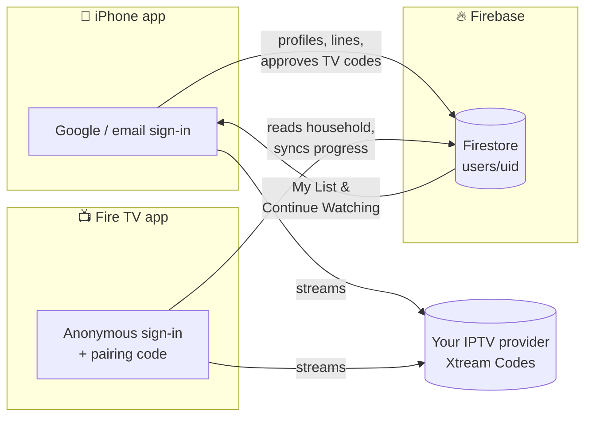

<div align="center">


<br>

**A Netflix-style home for your own IPTV subscription, on iPhone and Fire TV, with one account across both.**

<br>


[Features](#-features) · [Screenshots](#-screenshots) · [How it works](#-how-it-works) · [Getting started](#-getting-started) · [Project layout](#-project-layout) · [Privacy](#-privacy--security)

</div>

---

## ✨ Why NucFlix?

IPTV apps usually look like spreadsheets of channels. NucFlix turns any **Xtream Codes** line into a Netflix-style experience:

- Big artwork rows and a billboard.
- A "Who's watching?" screen with a profile for each person.
- Continue Watching that follows you from the couch to your phone.

You bring the IPTV subscription; NucFlix doesn't provide or host any content.

## 🚀 Features

<table>
<tr>
<td width="50%" valign="top">

### 📱 iPhone
- Live TV with a TV guide (EPG), Movies and Series
- Plays almost anything (MKV, TS, HLS…) with **MobileVLCKit**
- **Downloads** for offline viewing
- **AirPlay** and **Picture-in-Picture**
- Sign in with **Google** or email
- Manage people, kids profiles, IPTV lines and paired TVs

</td>
<td width="50%" valign="top">

### 📺 Fire TV
- 10-foot UI built for the remote, at 1920×1080
- Native **Media3 ExoPlayer** playback under the web UI
- Timeline scrubbing with **thumbnail previews**
- **Autoplay next episode** with a countdown
- Repairs broken MPEG-TS timestamps from some providers
- Search from your phone with the built-in **phone helper**

</td>
</tr>
<tr>
<td colspan="2" valign="top">

### 🔄 One account, every screen
- **Profiles are people.** You, your partner, the kids: each person has their own My List, Continue Watching and recommendations.
- **Kids profiles** never show adult categories.
- **IPTV lines are shared** by the whole household and stored in the account. Your provider login is never saved on a device.
- **Pair a TV in seconds.** The TV shows an 8-character code; type it into the iPhone app.
- **Pick up where you left off.** Watch on the phone, finish on the TV.

</td>
</tr>
</table>

## 🖼 Screenshots

<div align="center">
<table>
<tr>
<td align="center"><br><sub><b>Fire TV:</b> pair with a code</sub></td>
<td align="center" rowspan="2"><br><sub><b>iPhone:</b> Who's watching?</sub></td>
</tr>
<tr>
<td align="center"><br><sub><b>Fire TV:</b> the same profiles on the TV</sub></td>
</tr>
</table>
</div>

## 🧠 How it works



1. **Sign in on the iPhone.** Add your IPTV line and the people in your household.
2. **Open NucFlix on the TV.** It signs in anonymously and shows a pairing code.
3. **Enter the code on the iPhone** (Settings → Pair a TV). The TV joins your household and shows **Who's watching?**
4. **Watch.** Each app holds the IPTV login in memory only while it plays. Favorites and playback positions sync live through Firestore.

<details>
<summary><b>Firestore data model</b></summary>

```
users/{uid}
├── lines/{lineId}              IPTV lines: name, serverURL, username, password
├── profiles/{profileId}        people: name, avatar colour, kids, prefs
│   ├── favorites/{contentKey}  My List
│   └── progress/{contentKey}   Continue Watching (position, duration, device)
├── members/{tvUid}             paired TVs
└── devices/{uid}
pairing/{code}                  short-lived TV pairing codes
```

Content keys look like `<lineId>:<kind>:<id>`, so titles from different providers never collide.

</details>

## 🛠 Getting started

You'll need a Firebase project with **Authentication** (Google, Email/Password and Anonymous) and **Cloud Firestore** enabled.

### 1. Firebase rules

```bash
cd firebase
npm install
npm test               # runs the security-rules tests against the local emulators
npm run deploy:rules   # deploy once they pass
```

### 2. iPhone app

```bash
./scripts/fetch-vlckit.sh   # downloads MobileVLCKit (~1 GB unpacked, kept out of git)
open NucFlix.xcodeproj
```

- Pick your team under **Signing & Capabilities** and run it on your iPhone.
- If you change the bundle ID (`com.priteshbhavsar.NucFlix`):
  - Register it as an iOS app in Firebase.
  - Replace `NucFlix/GoogleService-Info.plist` with the new app's config.
  - Update the `REVERSED_CLIENT_ID` URL scheme in `NucFlix/Info.plist`.
- With a free Apple ID, trust your developer profile on the phone under **Settings → General → VPN & Device Management**.

### 3. Fire TV app

No Gradle needed. The build script calls the Android SDK tools directly.

```bash
cd NucFlixFireTV
./build.sh                    # → build/NucFlix.apk (aapt2 → javac → R8 → zipalign → apksigner)
./build.sh --install          # build, install and launch on your Fire TV
./build.sh --debug --install  # debuggable build (chrome://inspect works for the WebView UI)
```

| Setting | Where | Example |
| --- | --- | --- |
| Android SDK | `ANDROID_SDK` | `~/Library/Developer/Xamarin/android-sdk-macosx` (default) |
| Fire TV address | `local.properties` → `firetv=` or `FIRETV` | `192.168.1.50:5555` |
| Keystore password | `local.properties` → `storePass=` | created on the first build |

- The first build downloads the Media3 ExoPlayer jars and R8 (`fetch-libs.sh`).
- The first build also creates a signing key. **Back up `keystore.jks` and `local.properties` together.** A build signed with a different key can't update the installed app; it has to be uninstalled first, which unpairs the TV.
- To point the Fire TV app at your own Firebase project, put that project's web app config in `NucFlixFireTV/web/firebase-config.js`.

### 🧪 Developing against the emulators

```bash
cd firebase && npx firebase emulators:start --only auth,firestore
```

- **iPhone:** debug builds launched with `-useFirebaseEmulator` use Auth on port 9099 and Firestore on 8181.
- **Fire TV UI:** serve `NucFlixFireTV/web/` from `localhost` in a desktop browser and it uses the emulators automatically.

## 📁 Project layout

```
.
├── NucFlix/                  iPhone app (SwiftUI)
│   ├── Models/               Xtream models, downloads, watch history
│   ├── Services/             Firebase account & sync, Xtream API, recommendations
│   └── Views/                Home, Live TV, Movies, Series, Search, player, account
├── NucFlix.xcodeproj
├── NucFlixFireTV/            Fire TV app
│   ├── src/                  Java: activity, ExoPlayer, Xtream proxy, phone helper
│   ├── web/                  10-foot UI (HTML/CSS/JS) + Firebase sync (cloud.js)
│   └── build.sh              Gradle-less build
├── firebase/                 Firestore rules, emulator tests, deploy scripts
├── scripts/fetch-vlckit.sh   downloads the iOS player engine
└── docs/images/              README artwork
```

## 🔒 Privacy & security

- **IPTV logins stay in the account.** They live in Firestore and are only held in memory on devices.
  - Firestore runs with a memory-only cache on both apps.
  - Downloads are saved with the login replaced by placeholders.
  - The iPhone keeps no on-disk HTTP cache of provider API calls.
- **Locked-down data.** Firestore rules only let you and your paired TVs read your household. Paired TVs can save watch progress, My List and profile preferences, but can't change lines, profiles or pairings. Emulator tests cover the rules.
- **Expiring pairing codes.** Codes last at most 15 minutes and are deleted once used.
- **Release builds aren't debuggable.** The Fire TV WebView can only be inspected in `--debug` builds.

## 🗺 Roadmap

- [x] Shared household account with people profiles and kids mode
- [x] TV pairing, synced My List and Continue Watching
- [ ] "Now playing" hand-off: move what's playing between phone and TV
- [ ] Sync recommendation history (currently stored per device)

## ⚖️ Disclaimer

NucFlix is a player. It doesn't include, host or sell any channels or content, so use it only with IPTV services you're entitled to. It isn't affiliated with or endorsed by Netflix, Amazon, Apple or Google; all trademarks belong to their owners.

<div align="center">
<br>

<br>
<sub>Made for the couch. 🍿</sub>
</div>
