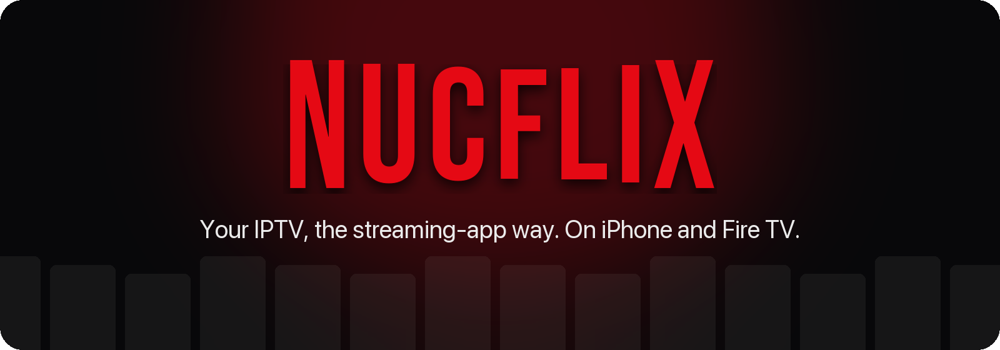
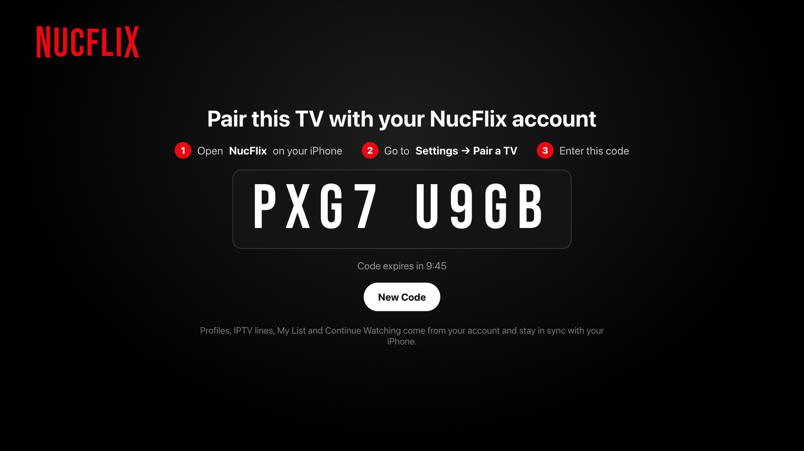
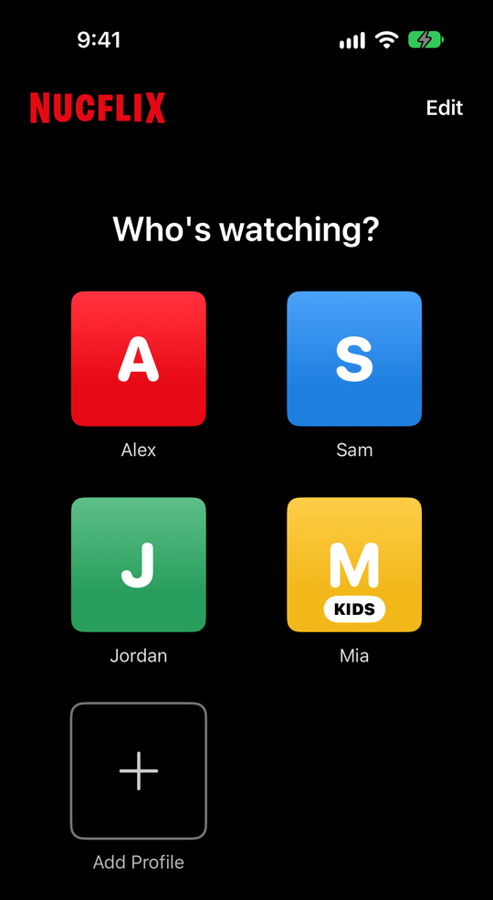
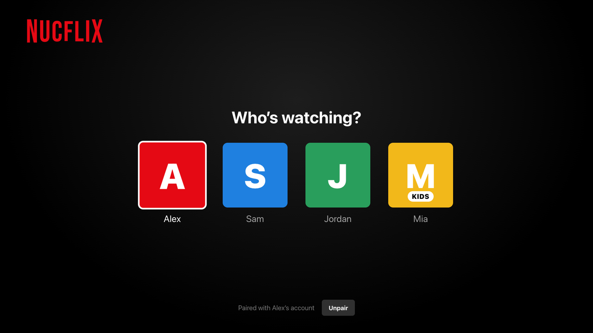
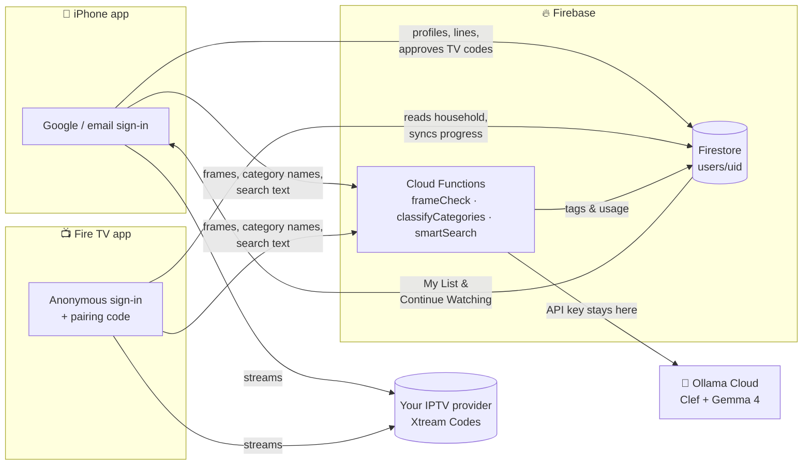
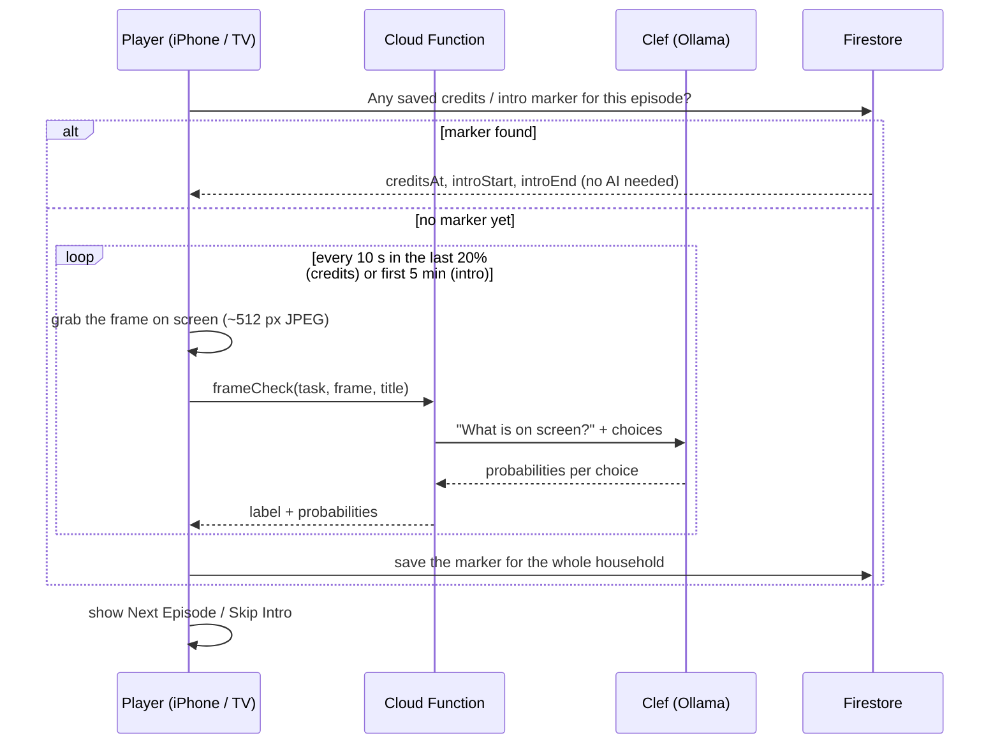

<div align="center">



<br>

**A Netflix-style home for your own IPTV subscription, on iPhone and Fire TV, with one account across both.**

<br>


[](LICENSE)

[Features](#-features) · [Smart features](#-smart-features) · [Screenshots](#-screenshots) · [How it works](#-how-it-works) · [Getting started](#-getting-started) · [Project layout](#-project-layout) · [Privacy](#-privacy--security) · [License](#-license)

</div>

---

## ✨ Why NucFlix?

IPTV apps usually look like spreadsheets of channels. NucFlix turns any **Xtream Codes** line into a Netflix-style experience:

- Big artwork rows and a billboard.
- A "Who's watching?" screen with a profile for each person.
- Continue Watching that follows you from the couch to your phone.
- A bit of AI where it helps: it **sees** when the end credits really start, finds the intro to skip, spots dead channels, keeps kids profiles kid-safe and understands searches like *"funny hindi movies from the 2010s"*.

You bring the IPTV subscription; NucFlix doesn't provide or host any content.

## 🚀 Features

<table>
<tr>
<td width="50%" valign="top">

### 📱 iPhone
- Live TV with a TV guide (EPG), Movies and Series
- Plays almost anything (MKV, TS, HLS…) with **MobileVLCKit**
- **Downloads** for offline viewing
- **AirPlay** and **Picture-in-Picture**
- **Next episode when the credits start**, **Skip Intro**, dead-channel check and smart search (see [Smart features](#-smart-features))
- Sign in with **Google** or email
- Manage people, kids profiles, IPTV lines and paired TVs

</td>
<td width="50%" valign="top">

### 📺 Fire TV
- 10-foot UI built for the remote, at 1920×1080
- Native **Media3 ExoPlayer** playback under the web UI
- Timeline scrubbing with **thumbnail previews**
- **Autoplay next episode** with a countdown, timed to the real end credits
- **Skip Intro** and the dead-channel check, using frames grabbed from the player
- Repairs broken MPEG-TS timestamps from some providers
- Search from your phone with the built-in **phone helper**

</td>
</tr>
<tr>
<td colspan="2" valign="top">

### 🔄 One account, every screen
- **Profiles are people.** You, your partner, the kids: each person has their own My List, Continue Watching and recommendations.
- **Kids profiles** only show categories the AI tagged as kid-friendly, and never adult ones.
- **IPTV lines are shared** by the whole household and stored in the account. Your provider login is never saved on a device.
- **Pair a TV in seconds.** The TV shows an 8-character code; type it into the iPhone app.
- **Pick up where you left off.** Watch on the phone, finish on the TV. Finished episodes are marked watched and Continue Watching moves on to the next one.

</td>
</tr>
</table>

## 🤖 Smart features

NucFlix uses two models on [Ollama Cloud](https://ollama.com), always through Firebase Cloud Functions so the apps never hold the API key:

- **[Clef](https://ollama.com/library/clef)**, a decision model that can read images, answers multiple-choice and yes/no questions about video frames and category names.
- **[Gemma 4](https://ollama.com/library/gemma4)** turns a search written in plain language into catalog filters.

Everything works on both the iPhone and the Fire TV, and every feature falls back to the normal behaviour if the AI is unavailable.

| | Feature | What you see |
| --- | --- | --- |
| 🎬 | **Real end-of-episode detection** | "Next Episode" appears when the **end credits actually start**, not just in the last 25 seconds, then plays on after a 10-second countdown. The episode counts as watched from that moment. |
| ⏭ | **Skip Intro** | A Skip Intro button over the opening titles of a series. The first person in the household to watch a show's opening finds it; everyone gets the button after that. |
| 📡 | **Dead channel check** | About 13 seconds into a live channel showing a **black, frozen or "no signal"** picture, a banner offers the same station in another quality ("Try Sky News HD"), switching in place. |
| 🧒 | **Kid-safe categories** | Every provider category gets tagged for kids-suitability, adult content, language and genre. Kids profiles only see kid-friendly categories, and adult ones are hidden even when the provider names them oddly. |
| 🔎 | **Smart search** | Type a request like *"scary films from the 80s"* or *"cricket channels in hindi"* and a ✨ section shows matching titles, with the filters it understood ("Horror movies, 1980–1989"). |

## 🖼 Screenshots

<div align="center">
<table>
<tr>
<td align="center"><br><sub><b>Fire TV:</b> pair with a code</sub></td>
<td align="center" rowspan="2"><br><sub><b>iPhone:</b> Who's watching?</sub></td>
</tr>
<tr>
<td align="center"><br><sub><b>Fire TV:</b> the same profiles on the TV</sub></td>
</tr>
</table>
</div>

## 🧠 How it works



1. **Sign in on the iPhone.** Add your IPTV line and the people in your household.
2. **Open NucFlix on the TV.** It signs in anonymously and shows a pairing code.
3. **Enter the code on the iPhone** (Settings → Pair a TV). The TV joins your household and shows **Who's watching?**
4. **Watch.** Each app holds the IPTV login in memory only while it plays. Favorites and playback positions sync live through Firestore.
5. **Smart features run in the background.** The apps call the household's Cloud Functions, which check that the caller is the account owner or a paired TV, count the call against a daily limit, then ask Ollama. Nothing in the player ever waits on the AI.

### How the smart features work



<details>
<summary><b>🎬 End credits → next episode</b></summary>

- Scanning starts at 80% of the runtime (or 10 minutes before the end) for anything longer than 5 minutes.
- Each frame is classified as **programme**, **end credits**, **next-episode preview** or **logo / black**.
- Credits count as started after one very sure answer (≥ 92%) or two answers ≥ 75% at least 8 seconds apart, so one dark scene doesn't end the episode early.
- The moment is saved as `creditsAt`. From then on the title saves as **watched**, and on later plays (on any device) the countdown appears at that point without asking the AI again.
- If no credits are found, the old behaviour still applies: the card appears in the last 25 seconds.

</details>

<details>
<summary><b>⏭ Skip Intro</b></summary>

- In the first 5 minutes of an episode, frames are classified as **programme**, **opening titles**, **"previously on" recap** or **logo / black**. On-screen captions and news tickers count as programme.
- Two opening-title sightings in a row (≥ 75%) mark the start; the first normal frame after that marks the end.
- `introStart` / `introEnd` are saved, and the button shows between them for everyone in the household.
- If nothing is found in the first 4 minutes (and the scan really watched the start), "no intro" is saved so it isn't checked again.

</details>

<details>
<summary><b>📡 Dead channel check</b></summary>

- After 10 seconds of playback, the player grabs two frames 3 seconds apart.
- Clef picks **ok**, **black**, **frozen** or **offline** (error cards, "no signal", test patterns).
- If the two frames are byte-identical, it gets a sharper question instead: is the programme stuck mid-motion, or is this a screen that's meant to be still, like a radio station card?
- The banner only appears for an answer ≥ 70%, and offers channels whose names match once quality tags (HD, FHD, 4K…) and country prefixes are removed.

</details>

<details>
<summary><b>🧒 Category tags</b></summary>

- When a line's catalog loads, any category without tags is sent in batches of 16 (four questions each, the per-request maximum).
- Clef answers: is it suitable for a child under 12? Is it sexually explicit? Which language? Which genre?
- Tags are stored once per line in `lineTags/{lineId}` and shared by every device. Only the Cloud Function can write them.
- Adult categories are hidden above 70% (on top of the name-based filter). Kids profiles hide anything under 50% kid-suitable.

</details>

<details>
<summary><b>🔎 Smart search</b></summary>

- Searches of three words or more also go to Gemma 4, which returns JSON filters: kind, keywords, genres, languages, year range and sort order.
- The app applies them to the catalog it already has: language and genre come from the category tags, the year from the title. A plain title search never calls the AI.

</details>

<details>
<summary><b>Firestore data model</b></summary>

```
users/{uid}
├── lines/{lineId}              IPTV lines: name, serverURL, username, password
├── profiles/{profileId}        people: name, avatar colour, kids, prefs
│   ├── favorites/{contentKey}  My List
│   └── progress/{contentKey}   Continue Watching (position, duration, device)
├── members/{tvUid}             paired TVs
├── devices/{uid}
├── markers/{contentKey}        AI: where the credits start / the intro runs (shared by the household)
└── lineTags/{lineId}           AI: kids, adult, language and genre per category (written by Cloud Functions)
aiUsage/{uid}                   daily AI call count (Cloud Functions only)
pairing/{code}                  short-lived TV pairing codes
```

Content keys look like `<lineId>:<kind>:<id>`, so titles from different providers never collide.

</details>

## 🛠 Getting started

You'll need a Firebase project with **Authentication** (Google, Email/Password and Anonymous) and **Cloud Firestore** enabled.
The smart features also need the **Blaze (pay-as-you-go) plan** for Cloud Functions and an **[Ollama](https://ollama.com) API key**. Without them the apps still work, just without the AI.

### 1. Firebase rules

```bash
cd firebase
npm install
npm test               # runs the security-rules tests against the local emulators
npm run deploy:rules   # deploy once they pass
```

### 2. AI Cloud Functions (optional)

```bash
cd firebase/functions && npm install && cd ..
npx firebase functions:secrets:set OLLAMA_API_KEY   # paste your Ollama key when asked; it lives in Secret Manager
npm run test:functions                               # emulator tests with a fake AI (no key needed)
npm run deploy:functions                             # frameCheck, classifyCategories, smartSearch in us-central1
```

- Each household gets **4,000 AI calls a day** (`DAILY_LIMIT` in `functions/index.js`). Normal viewing uses a few dozen; tagging a big catalog the first time uses one call per 16 categories.
- To check accuracy against the **real** models, move `functions/.secret.local` aside so the emulator reads the key from Secret Manager, start the emulators, and run `node test/live-ai.mjs <folder of test frames>`. Each run costs a few cents.

### 3. iPhone app

```bash
./scripts/fetch-vlckit.sh   # downloads MobileVLCKit (~1 GB unpacked, kept out of git)
open NucFlix.xcodeproj
```

- Pick your team under **Signing & Capabilities** and run it on your iPhone.
- If you change the bundle ID (`com.priteshbhavsar.NucFlix`):
  - Register it as an iOS app in Firebase.
  - Replace `NucFlix/GoogleService-Info.plist` with the new app's config.
  - Update the `REVERSED_CLIENT_ID` URL scheme in `NucFlix/Info.plist`.
- With a free Apple ID, trust your developer profile on the phone under **Settings → General → VPN & Device Management**.

### 4. Fire TV app

No Gradle needed. The build script calls the Android SDK tools directly.

```bash
cd NucFlixFireTV
./build.sh                    # → build/NucFlix.apk (aapt2 → javac → R8 → zipalign → apksigner)
./build.sh --install          # build, install and launch on your Fire TV
./build.sh --debug --install  # debuggable build (chrome://inspect works for the WebView UI)
```

| Setting | Where | Example |
| --- | --- | --- |
| Android SDK | `ANDROID_SDK` | `~/Library/Developer/Xamarin/android-sdk-macosx` (default) |
| Fire TV address | `local.properties` → `firetv=` or `FIRETV` | `192.168.1.50:5555` |
| Keystore password | `local.properties` → `storePass=` | created on the first build |

- The first build downloads the Media3 ExoPlayer jars and R8 (`fetch-libs.sh`).
- The first build also creates a signing key. **Back up `keystore.jks` and `local.properties` together.** A build signed with a different key can't update the installed app; it has to be uninstalled first, which unpairs the TV.
- To point the Fire TV app at your own Firebase project, put that project's web app config in `NucFlixFireTV/web/firebase-config.js`.

### 🧪 Developing against the emulators

```bash
echo 'OLLAMA_API_KEY=mock' > firebase/functions/.secret.local   # once: fake AI answers, no key or cost
cd firebase && npx firebase emulators:start --only auth,firestore,functions
```

- **iPhone:** debug builds launched with `-useFirebaseEmulator` use Auth on port 9099, Firestore on 8181 and Functions on 5001.
- **Fire TV UI:** serve `NucFlixFireTV/web/` from `localhost` in a desktop browser and it uses the emulators automatically.
- **Fake AI answers:** the mock tags categories from their names and parses searches with simple rules. Frame answers come from `firebase/functions/.mock-frames.json`, which you can edit while an app is running, e.g. `{"credits": "end_credits", "intro": "intro", "live": "black"}`.

## 📁 Project layout

```
.
├── NucFlix/                  iPhone app (SwiftUI)
│   ├── Models/               Xtream models, downloads, watch history
│   ├── Services/             Firebase account & sync, Xtream API, recommendations, SmartAI (AI calls + player checks)
│   └── Views/                Home, Live TV, Movies, Series, Search, player, account
├── NucFlix.xcodeproj
├── NucFlixFireTV/            Fire TV app
│   ├── src/                  Java: activity, ExoPlayer, frame capture, Xtream proxy, phone helper
│   ├── web/                  10-foot UI (HTML/CSS/JS), Firebase sync (cloud.js), AI helpers (smart.js)
│   └── build.sh              Gradle-less build
├── firebase/                 Firestore rules, emulator tests, deploy scripts
│   └── functions/            AI Cloud Functions (Ollama Clef + Gemma 4) and their mock
├── scripts/fetch-vlckit.sh   downloads the iOS player engine
└── docs/images/              README artwork
```

## 🔒 Privacy & security

- **IPTV logins stay in the account.** They live in Firestore and are only held in memory on devices.
  - Firestore runs with a memory-only cache on both apps.
  - Downloads are saved with the login replaced by placeholders.
  - The iPhone keeps no on-disk HTTP cache of provider API calls.
- **Locked-down data.** Firestore rules only let you and your paired TVs read your household. Paired TVs can save watch progress, My List and profile preferences, but can't change lines, profiles or pairings. Emulator tests cover the rules.
- **Expiring pairing codes.** Codes last at most 15 minutes and are deleted once used.
- **The AI key never leaves the server.** It's a Cloud Functions secret; the apps only call the household's functions, which check the caller is the account owner or a paired TV and enforce a daily limit.
- **What the AI sees.** Small (~512 px) JPEG frames during the checks described above, category names, and search text. Never your IPTV login, profiles or watch history. Frames are not stored.
- **Release builds aren't debuggable.** The Fire TV WebView can only be inspected in `--debug` builds.

## 🗺 Roadmap

- [x] Shared household account with people profiles and kids mode
- [x] TV pairing, synced My List and Continue Watching
- [x] AI: real end-credits detection, Skip Intro, dead-channel check, kid-safe category tags, smart search
- [ ] Use AI tags for genre rows on the home screen
- [ ] "Now playing" hand-off: move what's playing between phone and TV
- [ ] Sync recommendation history (currently stored per device)

## 📄 License

NucFlix is released under the [MIT License](LICENSE). © 2026 pri-te-sh.

Bundled third-party pieces keep their own licenses (the AI models run on Ollama Cloud under their own terms):
- The Firebase JavaScript SDK in `NucFlixFireTV/web/vendor/firebase/` (Apache 2.0).
- The Bebas Neue font in `NucFlixFireTV/web/fonts/` (SIL Open Font License, see `OFL.txt`).
- MobileVLCKit, downloaded by `scripts/fetch-vlckit.sh` (LGPL 2.1).

## ⚖️ Disclaimer

NucFlix is a player. It doesn't include, host or sell any channels or content, so use it only with IPTV services you're entitled to. It isn't affiliated with or endorsed by Netflix, Amazon, Apple or Google; all trademarks belong to their owners.

<div align="center">
<br>

<br>
<sub>Made for the couch. 🍿</sub>
</div>
